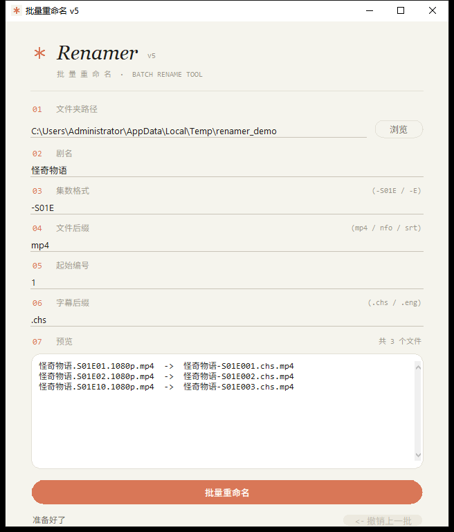
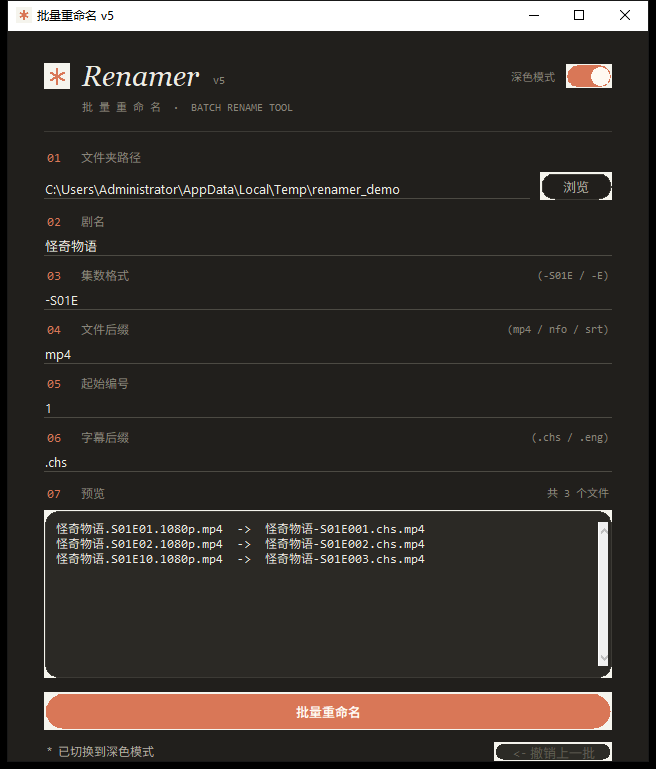

# 批量重命名 · Renamer v5

一个 Windows 小工具：批量给影视文件改名。命名规则统一、**先预览再动手**、改错了能**一键撤销**。

界面按「奶油暖底 + 陶土色点缀 + 衬线斜体标题 + 等宽编号标签 + 胶囊按钮」重做，**浅色 / 深色双主题**，右上角开关一键切换（选择会记住，下次打开还是你选的那套）。

纯 Python 标准库实现（tkinter），**零第三方依赖**。

## 截图

| 浅色 · 奶油 | 深色 · 暖夜 |
| :-: | :-: |
|  |  |

## 功能

- **命名规则**：`{剧名}{集数格式}{集号}{字幕后缀}.{后缀}`，例如 `怪奇物语-S01E001.chs.mp4`
- **实时预览**：任何输入变化都立刻重算「旧名 → 新名」列表，改之前心里有数
- **冲突标红**：目标文件已存在（且不属于本批次）时标红并**中止执行**，不会静默覆盖你的文件
- **两段式重命名**：遇到「新名正好是别人旧名」的链式情况，先改临时名再改终名，不会互相覆盖丢数据
- **撤销上一批**：改名是按批次记录的，随时可以整批改回来
- **自然排序**：`ep2.mp4` 排在 `ep10.mp4` 前面（不会把 10 排在 2 前面）
- **只动文件，不碰文件夹**：同名文件夹不会被误改名，非目标后缀的文件原样保留
- **双主题**：浅色奶油 / 深色暖夜，右上角胶囊开关切换，选择持久化
- 高 DPI 适配（缩放不发糊）；Win11 上标题栏/边框自动染成主题色

## 下载使用

不想配环境的话，直接下载仓库里打好的 exe，双击即用，**无需安装 Python**：

> [`dist/批量重命名_v5.exe`](dist/批量重命名_v5.exe)（单文件，约 9 MB）

首次运行时 Windows SmartScreen 可能提示「Windows 已保护你的电脑 / 未知发布者」——点「更多信息 → 仍要运行」即可（个人小工具没有购买代码签名证书，正常现象）。

## 使用方法

1. **选文件夹**：填路径或点「浏览」，选择存放视频的目录
2. **填字段**：剧名、集数格式、后缀、起始编号、字幕后缀（后缀和起始编号已有默认值）
3. **看预览**：卡片里逐行列出「旧名 → 新名」，红色的行是冲突，执行前先解决
4. **点「批量重命名」**：状态行会报告改了若干个文件
5. **不满意**：点「<- 撤销上一批」，整批还原

> PS：重命名会修改文件扩展名相关的命名，请确保文件夹选项中已开启「显示文件扩展名」的认知，且文件没有被其他程序占用。

## 从源码运行

需要 Python 3.8+（Windows 官方安装包自带 tkinter）：

```bat
python 批量重命名_v5.py
```

## 自己打包 exe

在仓库根目录执行（cmd / PowerShell 均可）：

```bat
python -m venv .build/venv
.build\venv\Scripts\python.exe -m pip install pyinstaller
.build\venv\Scripts\python.exe make_ico.py
.build\venv\Scripts\python.exe -m PyInstaller --onefile --windowed --name "批量重命名_v5" --icon icon.ico --distpath dist --workpath .build/work --specpath .build 批量重命名_v5.py
```

产物是 `dist/批量重命名_v5.exe`。`icon.ico` 由 `make_ico.py` 用代码现画（奶油底 + 陶土色六角星），不依赖任何图片素材。

## 字段与命名规则

| 字段 | 说明 | 示例 |
| --- | --- | --- |
| 文件夹路径 | 目标目录（不递归子目录） | `D:\Media\怪奇物语` |
| 剧名 | 新文件名的前缀 | `怪奇物语` |
| 集数格式 | 剧名与集号之间的风格分隔 | `-S01E` |
| 文件后缀 | 只处理这个后缀的文件 | `mp4` |
| 起始编号 | 第一集的编号 | `1` |
| 字幕后缀 | 集号之后、扩展名之前 | `.chs` |

集号统一补零到 3 位：`怪奇物语-S01E001.chs.mp4`、`怪奇物语-S01E002.chs.mp4` ……

## 已知限制

- 标题栏染色依赖 Win11 的 DWM API；Win10 上原生标题栏保持系统颜色（功能不受影响）
- 只处理所选文件夹内的一层文件，不递归子目录
- 预览列表最多显示 300 行，超出部分从略（不影响实际改名数量）
- 一次只记一批撤销历史，撤销后该批记录即清空

## 文件说明

| 文件 | 说明 |
| --- | --- |
| `批量重命名_v5.py` | 当前版本源码（双主题 + 预览 + 冲突检测 + 撤销） |
| `批量重命名_v4.py` | 初版源码，保留作对照 |
| `make_ico.py` | 生成 `icon.ico` 的脚本 |
| `icon.ico` | 应用图标（由 `make_ico.py` 生成） |
| `dist/批量重命名_v5.exe` | 预编译版，下载即用 |

## 版本记录

- **v5**：界面全面重做（双主题）；新增实时预览、冲突标红、撤销上一批、自然排序；修复 v4 的两个数据安全隐患（目标已存在时静默覆盖、链式重命名互相覆盖）
- **v4**：初版，按 tkinter 原生控件拼装，实现基础批量重命名
